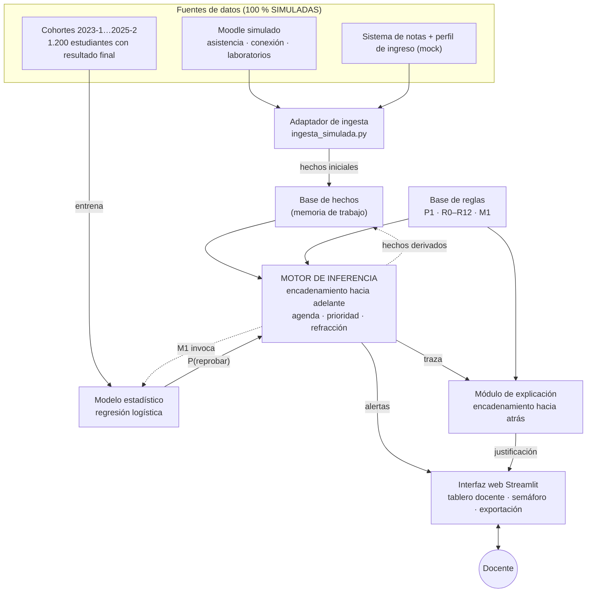

# Arquitectura del Sistema Experto de Alertas Tempranas en Ciencias Básicas

**Curso:** Sistemas Expertos (ISOFBL143) · UNIMINUTO · 2026-2 · Unidad 2 — RAC 2
**Equipo:** Daniel Andrei Londoño Barrera · Sarai Sredny López Robles
**Proyecto:** Alertas Deserción — cursos de Programación en C++ y Estructuras de Datos

> Fuentes de este diseño: `Plantilla_Arquitectura_Sistemas_Expertos.xlsx` (hoja 2), `Plantilla_Entrevista_al_Experto 1.xlsx` (hojas 2–5), `ISOFBL143_Clasifica_y_Elige` (Parte C) y las guías de las semanas 10, 11 y 12.

---

## 1. Clasificación del sistema

| Elemento | Definición |
|---|---|
| Objetivo | Detectar antes de la semana 4 qué estudiantes de C++ y Estructuras de Datos están en riesgo de reprobar y decirle al docente a quién atender primero. |
| Tipo funcional | **Predicción**: estima un resultado futuro (reprueba o no) y lo clasifica en tres niveles de riesgo. |
| Técnica de razonamiento | **Híbrida**: modelo estadístico entrenado con cohortes anteriores + reglas de producción SI…ENTONCES del experto. |
| Usuario | Docente de aula (principal); coordinación académica y consejería (secundarios). |
| Salida | Semáforo ROJO / AMARILLO / VERDE, probabilidad porcentual de reprobar, acciones y justificación trazable. |

## 2. Diagrama de componentes y flujo de datos

### Flujo de una evaluación (por estudiante, en el corte de la semana 3)

1. **Ingesta**: el adaptador entrega una fila por estudiante y semana (asistencia, faltas justificadas, horas en Moodle, días sin ingresar, notas de laboratorios 1 y 2, perfil de ingreso).
2. **Hechos iniciales**: la fachada (`sistema.py`) convierte la fila en hechos: `asistencia_bruta`, `labs_sin_entregar`, etc.
3. **Fase Preparación**: P1 crea la asistencia de trabajo; R8 la recalcula si hay faltas justificadas.
4. **Fase Modelo**: M1 invoca el modelo estadístico y agrega el hecho `prob_reprobar`.
5. **Fase Clasificación**: R0–R5, R7, R9 y R10 agregan conclusiones candidatas (colores).
6. **Fase Escalamiento**: R6 sube de AMARILLO a ROJO si el laboratorio 2 también se perdió.
7. **Fase Completitud**: R11/R12 clasifican por bandas de probabilidad si ninguna otra regla lo hizo.
8. **Resolución**: semáforo final = color más severo entre candidatos no anulados (prudencia). R7 anula los ROJO de R0/R1/R2.
9. **Explicación**: la traza y el encadenamiento hacia atrás producen "¿por qué?" / "¿por qué no?".
10. **Interfaz**: tablero ordenado por prioridad, detalle por estudiante y exportación CSV/Excel.

## 3. Componentes

| Componente | Responsabilidad | Implementación |
|---|---|---|
| Adaptador de ingesta (simulado) | Sustituye a Moodle y al sistema de notas. Genera 150–300 estudiantes ficticios con una semilla fija (mismos datos para todos los evaluadores) y 1.200 registros históricos con resultado final. También acepta un CSV con el mismo esquema. | `se_alertas/ingesta_simulada.py` |
| Ontología | Entidades, relaciones, taxonomía de riesgo y glosario. | `se_alertas/ontologia.py` |
| Base de conocimiento | Reglas declarativas (hecho, operador, umbral) con certeza, origen en la entrevista, prioridad y fase. Umbrales editables. | `se_alertas/base_conocimiento.py` |
| Modelo estadístico | Regresión logística (scikit-learn) entrenada con cohortes anteriores; devuelve P(reprobar) y el aporte de cada variable. | `se_alertas/modelo_estadistico.py` |
| Motor de inferencia | Encadenamiento hacia adelante (alerta) y hacia atrás (explicación). | `se_alertas/motor_inferencia.py` |
| Módulo de explicación | Narrativa, árbol "¿por qué? / ¿por qué no?", justificación corta para la tabla. | `se_alertas/explicacion.py` |
| Fachada | Orquesta el flujo por estudiante y por curso. | `se_alertas/sistema.py` |
| Interfaz | Tablero web desplegado en Streamlit Community Cloud. | `app.py` |

**Por qué la ingesta simulada no afecta el diseño:** el resto del sistema depende solo del *esquema* de datos (`COLUMNAS_ESTUDIANTE`). Para pasar a producción se reemplaza `FuenteMoodleSimulada` por un conector a los web services de Moodle sin tocar reglas, motor ni interfaz.

## 4. Representación del conocimiento

### 4.1 Base de hechos (memoria de trabajo)

| Hecho | Origen |
|---|---|
| `asistencia_bruta`, `faltas_justificadas`, `sesiones_programadas`, `sesiones_asistidas` | Ingesta (Moodle simulado) |
| `horas_moodle_semana`, `dias_sin_ingreso_moodle` | Ingesta (Moodle simulado) |
| `nota_lab1`, `nota_lab2` (vacío = sin entregar), `labs_sin_entregar` | Ingesta (sistema de notas simulado) |
| `puntaje_admision_mat`, `repite_materia`, `trabaja_tiempo_completo` | Ingesta (perfil de ingreso) |
| `asistencia` (de trabajo / ajustada) | Derivado por P1 o R8 |
| `prob_reprobar` | Derivado por M1 (modelo) |
| `semaforo_provisional`, `n_candidatos` | Derivados por el motor en cada ciclo |

### 4.2 Ontología

* **Entidades:** Estudiante, Curso, Sesión de clase, Laboratorio, Actividad Moodle, Alerta, Docente.
* **Relaciones:** Estudiante *cursa* Curso; Curso *es dictado por* Docente; Estudiante *asiste a* Sesión, *presenta* Laboratorio, *genera* Actividad Moodle y *recibe* Alerta; Docente *atiende* Alerta; Alerta *se clasifica como* Semáforo.
* **Taxonomía de riesgo:** ALTO = ROJO > MEDIO = AMARILLO > BAJO = VERDE.
* **Conceptos:** mortalidad académica, deserción, inactividad, desbordamiento de memoria, asistencia ajustada, probabilidad de reprobar.

### 4.3 Reglas de producción

Umbrales tomados de la entrevista (preguntas 3, 4, 5, 6, 8, 9 y 12). Todas son editables desde la interfaz.

| ID | Regla | Certeza | Origen | Prioridad / fase |
|---|---|---|---|---|
| P1 | SI se conoce la asistencia registrada ENTONCES tomarla como asistencia de trabajo | Alta | Control del motor *(agregada)* | 100 · Preparación |
| R8 | SI hay faltas justificadas Y la asistencia es < 70 % ENTONCES descontarlas y recalcular la asistencia | Media | Pregunta 7 | 90 · Preparación |
| M1 | SI la asistencia de trabajo está disponible ENTONCES calcular P(reprobar) con el modelo | Alta | Hoja 2 *(agregada)* | 80 · Modelo |
| R0 | SI asistencia < 70 % Y lab 1 < 3,0 Y Moodle ≤ 2 h/sem ENTONCES ROJO y avisar al docente antes de la semana 4 | Alta | Pregunta 1 (caso 0) | 60 · Clasificación |
| R7 | SI asistencia < 70 % Y Moodle ≥ 4 h/sem Y lab 1 ≥ 3,5 ENTONCES AMARILLO (no ROJO) y consultar la causa externa | Media | Pregunta 5 | 58 · Clasificación (excepción) |
| R1 | SI asistencia < 70 % Y lab 1 < 3,0 ENTONCES ROJO y citar a tutoría individual | Alta | Pregunta 1 | 55 · Clasificación |
| R2 | SI P(reprobar) ≥ 70 % ENTONCES ROJO y citar a tutoría individual | Alta | Pregunta 12 | 55 · Clasificación |
| R3 | SI P(reprobar) entre 40 % y 69 % Y Moodle < 2 h/sem ENTONCES AMARILLO y monitoreo semanal | Alta | Pregunta 6 | 50 · Clasificación |
| R4 | SI P(reprobar) < 40 % Y asistencia > 85 % ENTONCES VERDE y seguimiento normal | Alta | Pregunta 3 | 50 · Clasificación |
| R5 | SI asistencia ≥ 70 % Y lab 1 < 3,0 ENTONCES AMARILLO y refuerzo en punteros y memoria dinámica | Alta | Pregunta 4 | 50 · Clasificación |
| R9 | SI repite la materia Y asistencia < 80 % ENTONCES AMARILLO | Media | Pregunta 8 | 50 · Clasificación |
| R10 | SI ≥ 10 días sin ingreso a Moodle **O** hay un laboratorio sin entregar ENTONCES AMARILLO y contactar al estudiante | Media | Pregunta 9 | 50 · Clasificación |
| R6 | SI el semáforo es AMARILLO Y lab 2 < 3,0 ENTONCES subir a ROJO | Media | Pregunta 4 | 40 · Escalamiento |
| R11 | SI ninguna otra regla clasificó Y P(reprobar) entre 40 % y 69 % ENTONCES AMARILLO | Media | Hecho 12 *(agregada)* | 10 · Completitud |
| R12 | SI ninguna otra regla clasificó Y P(reprobar) < 40 % ENTONCES VERDE | Media | Hecho 12 *(agregada)* | 10 · Completitud |

Procedimiento de intervención (pregunta 10): ROJO → tutoría individual antes de la semana 4; AMARILLO → seguimiento semanal y refuerzo; VERDE → seguimiento normal.

### 4.4 Modelo estadístico

* **Algoritmo:** regresión logística con estandarización de variables.
* **Variables:** asistencia (ajustada), horas en Moodle, días sin ingresar, notas de laboratorios 1 y 2 (sin entregar = 0,0), puntaje de admisión en matemáticas, repite la materia, trabaja tiempo completo.
* **Entrenamiento:** 1.200 estudiantes simulados de 6 cohortes (75 % entrenamiento / 25 % prueba). Con los datos simulados: AUC ≈ 0,89, exactitud ≈ 82 %.
* **Por qué este modelo:** su salida ya es una probabilidad y sus coeficientes son interpretables; eso alimenta la explicación ("qué variables pesaron más").

## 5. Motor de inferencia

**Tipo principal: encadenamiento hacia adelante (dirigido por datos).** Se justifica porque el sistema parte de los datos de la semana y debe llegar a una conclusión (la alerta) para *todos* los estudiantes. No hay una hipótesis previa que verificar.

Ciclo *reconocer → resolver conflicto → actuar*:

1. **Reconocer:** se arma la agenda (conjunto conflicto) con las reglas activas cuyas condiciones se cumplen y que no se han disparado.
2. **Resolver conflicto:** (a) mayor prioridad (*salience*), (b) mayor especificidad (más condiciones), (c) orden en la base. **Refracción:** cada regla se dispara una sola vez por estudiante.
3. **Actuar:** la regla agrega o modifica hechos, invoca el modelo (M1) o agrega una conclusión candidata. El motor recalcula `semaforo_provisional` y `n_candidatos`.
4. Repetir hasta que la agenda quede vacía.

**Resolución del semáforo:** gana el color más severo (principio de prudencia: es más barato citar a tutoría a alguien que no lo necesitaba que perder a quien sí). **Excepción:** si R7 se dispara, se anulan los ROJO de R0, R1 y R2 (evita el falso positivo de la pregunta 5). R6 sí puede escalar después.

**Encadenamiento hacia atrás (dirigido por metas), solo para explicar.** Meta "semáforo = X" → reglas que concluyen X → ¿se cumplían sus condiciones? → si una condición usa un hecho derivado (`asistencia`, `prob_reprobar`), se pregunta qué regla lo produjo. Así se responde "¿por qué ROJO?" y "¿por qué no VERDE?". Esto concuerda con la hoja 2 del Excel.

## 6. Interfaz y módulo de explicación

| Pestaña | Qué hace |
|---|---|
| Alertas | Botón *Ejecutar el sistema experto*; conteo por nivel de riesgo con una franja de proporciones; tabla ordenada por prioridad con el motivo principal en lenguaje claro; al seleccionar una fila se abre la ficha del estudiante; exportación CSV y Excel. |
| Estudiantes | Datos de entrada simulados (asistencia, Moodle, laboratorios, perfil) con filtro por curso. |
| Probar un caso | Consulta básica con casos de la entrevista precargados o valores libres. |
| Base de conocimiento | Reglas con nombre descriptivo y forma SI…ENTONCES, estrategia de control, modelo estadístico y ontología. |
| Arquitectura | Diagrama de componentes y mapa a archivos. |

**Ficha del estudiante (módulo de explicación).** Dos niveles de lectura:

* Para el docente: nivel de riesgo, probabilidad, cuatro indicadores clave, "Por qué" con motivos en lenguaje natural (sin códigos de regla) y "Qué hacer".
* Para el evaluador, en el desplegable *Ver el razonamiento del sistema*: "¿por qué?" / "¿por qué no?" (encadenamiento hacia atrás) con cada condición evaluada, la secuencia de inferencia paso a paso con las reglas en espera, y el peso de cada variable del modelo.

**Barra lateral:** origen de los datos (simulados o CSV), cantidad de estudiantes, umbrales del experto y reglas activas (por su descripción, agrupadas según el nivel de riesgo que concluyen). Desactivar una regla permite la auditoría cruzada.

**Diseño visual:** sobrio, sin emojis, con una paleta de tres colores de riesgo (rojo ladrillo, ocre y verde) y texto mínimo; el detalle técnico queda plegado.

Ejemplo de explicación para el docente (caso 0 de la entrevista): *Asiste al 58 % de las clases, obtuvo 1,8 en el laboratorio 1 y se conecta 2 horas por semana a Moodle. Comparado con estudiantes de semestres anteriores, su probabilidad de reprobar es muy alta (87 %).*

## 7. Herramienta elegida

**Python 3.12 + Streamlit + scikit-learn, con un motor de reglas propio.**

* La Parte C de la guía *Clasifica y Elige* preveía Python con Experta para las reglas. Al construir el prototipo se comprobó que **Experta 1.9.4 (último lanzamiento) no importa en Python 3.10 o superior**: depende de `frozendict 1.2`, que usa `collections.Mapping`, eliminado del lenguaje. Streamlit Community Cloud usa Python 3.12 por defecto.
* Por eso se implementó un motor de producción propio y declarativo (unas 200 líneas) con los mismos conceptos de CLIPS/Experta: memoria de trabajo, agenda, *salience*, refracción y especificidad. Ventajas: sin dependencias frágiles, encadenamiento hacia atrás para explicar y traza completa.
* **scikit-learn** para el modelo estadístico; **Streamlit** para la interfaz web y el despliegue gratuito con URL pública.

## 8. Alcance y limitaciones

* No reemplaza el criterio del docente, no asigna notas ni sanciones y no diagnostica causas personales o psicológicas.
* Los datos son **ficticios**: el desempeño del modelo (AUC) solo demuestra que el flujo funciona; con datos reales habría que reentrenar y recalibrar.
* El conocimiento tácito del docente ("se ve perdido en clase") no está formalizado.
* Riesgo de sesgo si se agregan variables socioeconómicas; la alerta orienta apoyo, nunca excluye.
* Próxima unidad: reemplazar la certeza cualitativa (Alta/Media) por **factores de certeza** numéricos.

